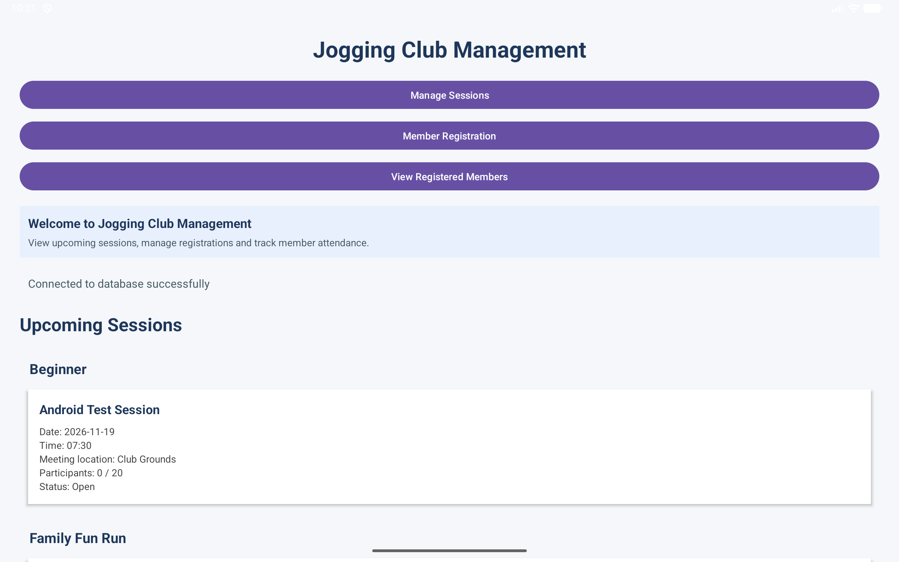
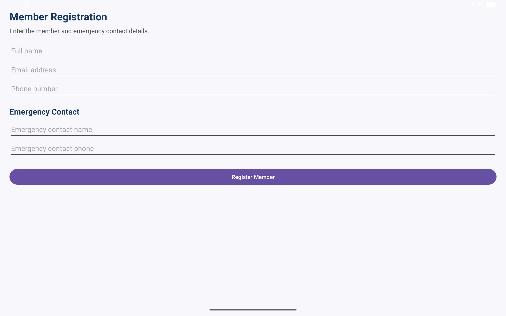
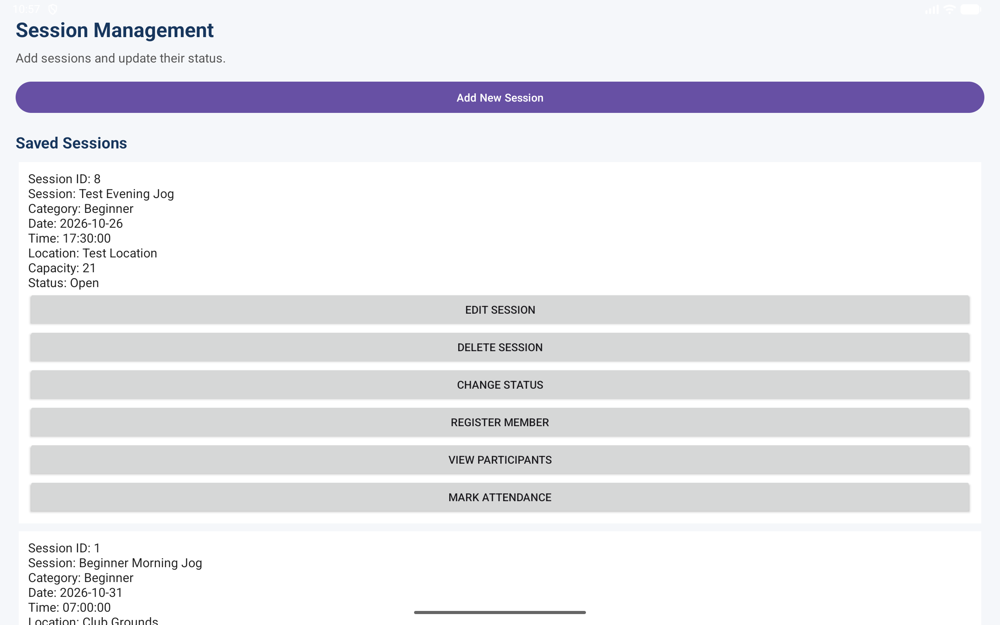
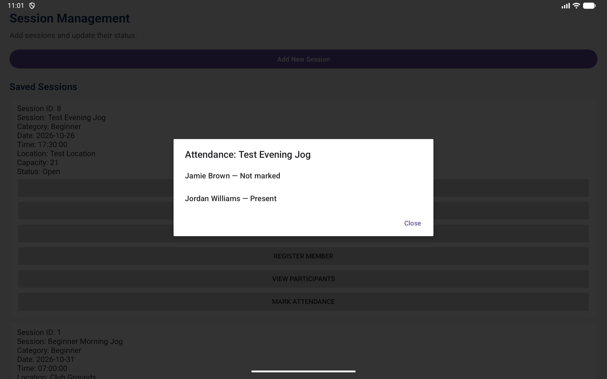
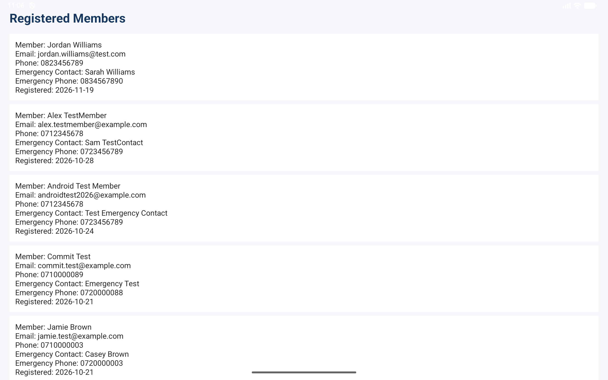
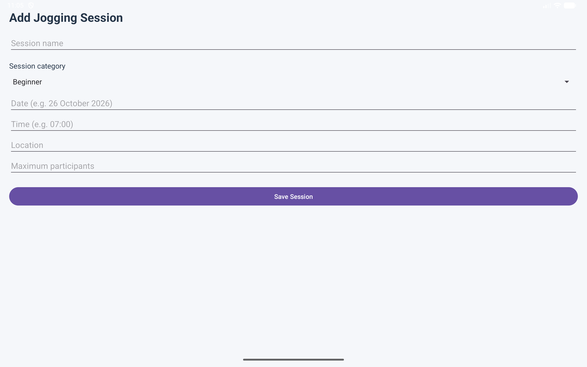

# Jogging Club Management System

A student-developed Android application for managing a jogging club. The application allows users to manage jogging sessions, register members, view registrations and record attendance.

The project consists of an Android application and a Java Spring Boot REST API connected to a MySQL database.

## Technologies Used

### Android Application
- Java
- Android Studio
- XML layouts
- Gradle

### Backend
- Java 17
- Spring Boot
- Spring JDBC (`JdbcTemplate`)
- Maven
- REST API

### Database and Tools
- MySQL
- Postman
- Git and GitHub

## Project Structure

```text
JoggingClubManagement/
├── android/
│   └── joggingclubmanagement/
└── backend/
    └── joggingclubapi/
```

## Main Features

- Manage jogging sessions.
- Register new club members.
- View registered members.
- Register members for jogging sessions.
- View session participants.
- Record attendance.
- Validate user input and prevent duplicate registrations.

## Application Architecture

The Android application communicates with the Spring Boot backend through HTTP requests.

The backend uses a layered structure:

- **Controller:** Handles incoming API requests.
- **Service:** Contains application logic and business rules.
- **Repository:** Handles database operations.

MySQL stores the application data, including members, sessions, registrations and attendance records.

## Database Setup

1. Install MySQL.
2. Create a database named `jogging_club_db`.
3. Configure the database connection using the provided `secrets.properties.example` file.
4. Create your local `secrets.properties` file using your own MySQL credentials.
5. Run the Spring Boot application.

The actual database credentials are not included in this repository.

## Running the Backend

1. Open the `backend/joggingclubapi` folder in an IDE.
2. Configure your MySQL database connection.
3. Run `JoggingclubapiApplication.java`.
4. The backend runs on port `8080` by default.

The API test endpoint is:

`http://localhost:8080/api/test`

## Running the Android Application

1. Open `android/joggingclubmanagement` in Android Studio.
2. Allow Gradle to synchronise.
3. Configure the API address to point to your running backend.
4. Run the application on an Android emulator or device.

The Android device and backend must be able to communicate over the network.

## Application Screenshots

The following screenshots demonstrate the main features of the Android application.

### Dashboard


### Member Registration


### Session Management


### Attendance


### Registered Members


### Add Jogging Session


## Learning Objectives

This project helped me practise:

- Developing Android applications using Java.
- Building REST APIs with Spring Boot.
- Separating application logic into controller, service and repository layers.
- Connecting Java applications to MySQL.
- Testing API endpoints using Postman.
- Using Git and GitHub for version control.

## Project Status

Completed as a student development project and used as a practical learning exercise in Android development and Java backend programming.